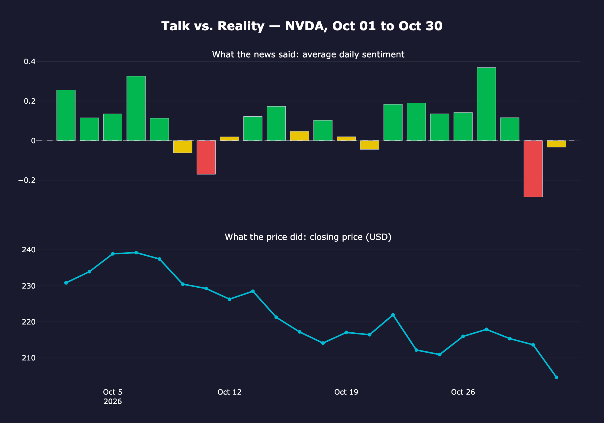
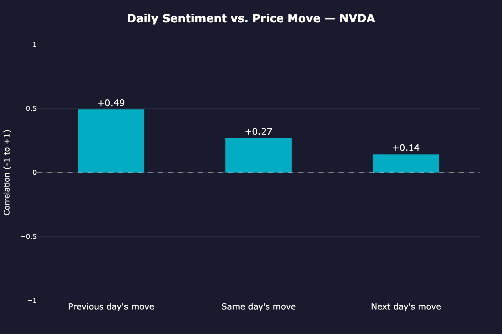

# Stock Sentiment Analyzer

**Does what the news says about a stock match what its price actually does?**

A Python project that compares **what people are saying** about a stock with **reality**. It collects financial news headlines, measures their sentiment with FinBERT (a transformer language model trained on financial text), and compares the daily sentiment with the stock's price movements over a month.

## How It Works

The project is built as connected modules:

1. **Collect:** `src/scraper.py` fetches recent news headlines about a company from NewsAPI.
2. **Score:** `src/sentiment.py` uses FinBERT to rate each headline as positive, negative, or neutral and gives it a score from -1 to +1.
3. **Compare:** `src/stocks.py` downloads current and historical stock prices from Yahoo Finance so they can be compared with the sentiment scores.
4. **Run:** `src/pipeline.py` runs all three steps for a ticker in a single function call.
5. **Track over time:** `src/history.py` collects and scores the headlines for every day in a date range, saves them to `data/`, and lines up each trading day's sentiment with that day's price change.

`notebook.ipynb` walks through the full analysis step by step, with charts and explanations. Part 1 looks at today's headlines; Part 2 compares a full month of daily sentiment with the price.

## Tools and Libraries

- **Python**
- **Data:** pandas, yfinance
- **News:** NewsAPI (`newsapi-python`)
- **Sentiment analysis:** Hugging Face Transformers (FinBERT), PyTorch
- **Visualization:** Plotly, Kaleido (chart export)

## Project Structure

```
Stock-Sentiment-Analyzer/
├── data/                  # Saved headlines and sentiment scores
├── iframe_figures/        # Charts exported from the notebook
├── src/
│   ├── scraper.py         # Collects news headlines
│   ├── sentiment.py       # Scores sentiment with FinBERT
│   ├── stocks.py          # Fetches stock price data
│   ├── pipeline.py        # Runs the full analysis
│   └── history.py         # Builds a month of daily sentiment vs. price
├── notebook.ipynb         # Main analysis notebook
├── requirements.txt       # Python dependencies
└── README.md
```

## Getting Started

### 1. Clone the repository

```bash
git clone https://github.com/LilitAsminian/Stock-Sentiment-Analyzer.git
cd Stock-Sentiment-Analyzer
```

### 2. Create and activate a virtual environment

```bash
python -m venv stockenv
source stockenv/bin/activate
```

### 3. Install dependencies

```bash
pip install -r requirements.txt
```

PyTorch is a large download, so the first install may take a few minutes. The FinBERT model is also downloaded the first time it runs.

### 4. Add your API key

Get a free key from [newsapi.org](https://newsapi.org) and create a file named `.env` in the project root:

```
NEWS_API_KEY=your_newsapi_key
```

Never commit this file. It is listed in `.gitignore`.

## Usage

- Run the full analysis for NVIDIA from the command line:
  ```bash
  python src/pipeline.py
  ```
- Or open `notebook.ipynb` in Jupyter or VS Code and run the cells to see each step with charts. The month of headlines used in Part 2 is saved in `data/`, so it loads without calling the API again.

## Results

Between October 1 and October 30, 2026, the project analyzed **1,664 NVIDIA headlines** across **22 trading days**.

- **The news was more positive than reality.** Headlines leaned positive on 17 of 22 days, with positive headlines outnumbering negative ones by almost 2 to 1. Meanwhile, the stock went up on only 9 days and fell **10.4%** over the month.
- **The news followed the price more than it predicted it.** Daily sentiment correlated most with the *previous* day's price move (+0.49), less with the same day's (+0.27), and barely with the next day's (+0.14). On days with a clear signal, the price moved the way the news leaned the next day only 8 times out of 16, no better than a coin flip.

With one stock and 22 trading days, these results are a strong hint, not proof.





## Author

Lilit Asminian ([@LilitAsminian](https://github.com/LilitAsminian))
